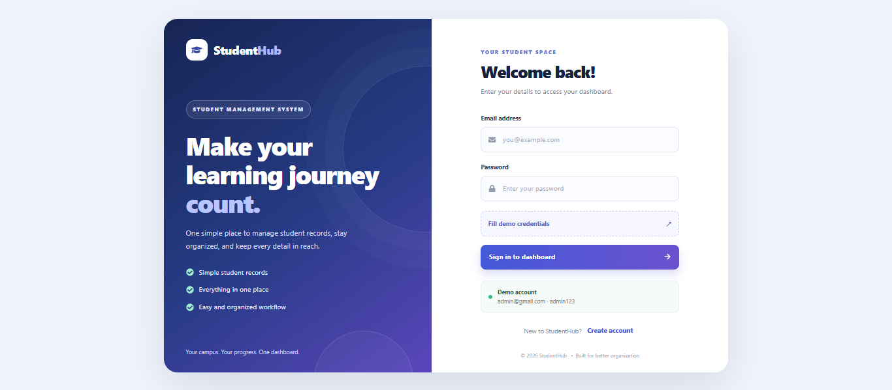
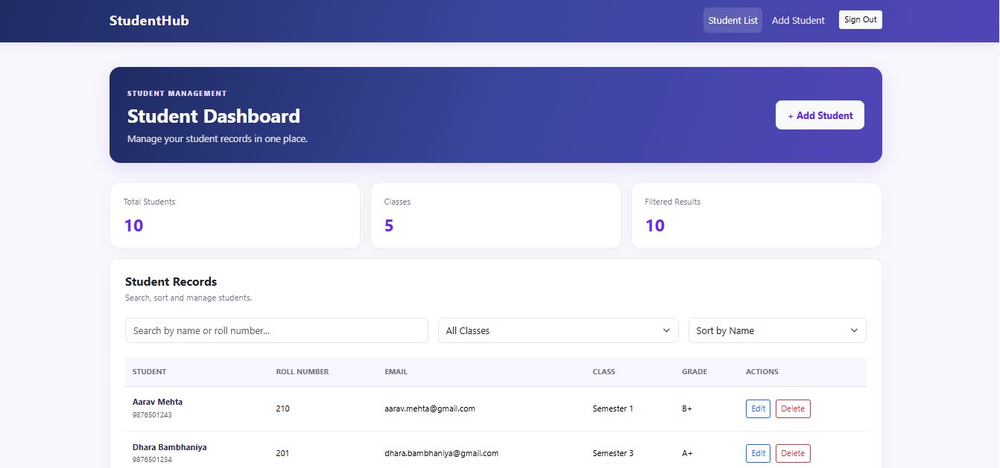

# StudentHub — Student Management System

A modern, responsive student management dashboard built with **React**. StudentHub helps users organize student records and perform common CRUD operations through a simple, easy-to-use interface.

## Preview

### Login Page



### Student Dashboard



> **Image setup:** Keep both `Login.png` and `Dashboard.png` inside the project's `public` folder. These Markdown paths are intended for the repository's README preview on GitHub.

## Features

- **Login interface** with demo-credential autofill
- **Protected routes** using React Router
- **Student dashboard** with total students, classes, and filtered-result counts
- **Student records table** with name, roll number, email, class, and grade
- **Search** by student name or roll number
- **Filter** records by class/semester
- **Sort** by name or roll number
- **Add student** records
- **Edit student** information
- **Delete student** records with a confirmation prompt
- **Responsive layout** using Bootstrap and custom CSS
- **Centralized state management** with Redux Toolkit
- **REST API integration** using JSON Server

## Technology Stack

| Technology | Purpose |
|---|---|
| React | Component-based user interface |
| React Router DOM | Navigation and protected routes |
| Redux Toolkit | Student state and asynchronous actions |
| React Redux | Connecting React components to Redux |
| Bootstrap | Responsive layout and UI styling |
| React Icons | Icons in the interface |
| JSON Server | Local REST API for student records |
| HTML, CSS, JavaScript | Web fundamentals and styling |

## Demo Login

Use **Fill demo credentials** on the login screen to autofill the sample account.

| Field | Demo value |
|---|---|
| Email | `admin@gmail.com` |
| Password | `admin123` |

**Authentication note:** The current implementation sets `isAuthenticated` in `localStorage` when the form is submitted; it does not verify the entered credentials with a real authentication service. This is for demonstration and learning only, not production security.

## Getting Started

### Prerequisites

- Node.js and npm
- A terminal and code editor
- JSON Server

### 1. Clone the repository

```bash
git clone https://github.com/bambhaniyadhara14/student-management.git
cd student-management
```

Replace the placeholders with your actual repository URL and folder name.

### 2. Install dependencies

```bash
npm install
```

If any packages used by the project are missing, install them:

```bash
npm install react-router-dom @reduxjs/toolkit react-redux react-icons bootstrap
npm install --save-dev json-server
```

### 3. Start the JSON Server API

The Redux slice is configured to use:

```text
http://localhost:3000/students
```

Make sure `db.json` is in the project root and contains the `students` array. In a separate terminal, start JSON Server:

```bash
npx json-server --watch db.json --port 3000
```

Keep this terminal running while using the app. The command can vary by JSON Server version; check your installed version if the command is not supported.

### 4. Start the React development server

For a Vite-based project:

```bash
npm run dev
```

Open the local address printed in the terminal. If your project uses a different setup, use the script defined in `package.json`.

## Project Structure

The exact structure may differ depending on how the project was created. A typical structure for the shared code is:

```text
project-root/
├── public/
│   ├── Dashboard.png
│   └── Login.png
├── src/
│   ├── components/
│   │   └── Navbar.jsx
│   ├── pages/
│   │   ├── Login.jsx
│   │   ├── StudentForm.jsx
│   │   └── StudentList.jsx
│   ├── redux/
│   │   ├── store.js
│   │   └── studentSlice.js
│   ├── App.jsx
│   ├── main.jsx
│   └── index.css
├── db.json
├── package.json
└── README.md
```

Update the names in this example to match your actual folders and files.

## Student Management Operations

| Operation | API method | Endpoint |
|---|---|---|
| Fetch students | `GET` | `/students` |
| Add a student | `POST` | `/students` |
| Update a student | `PUT` | `/students/:id` |
| Delete a student | `DELETE` | `/students/:id` |

**API base URL:** `http://localhost:3000`

## Student Record Fields

The sample data includes:

- `id`
- `rollNo`
- `name`
- `email`
- `phone`
- `course`
- `class`
- `grade`

The student form also supports `age` and `image`.

> **Development note:** In the shared code, the form uses `rollNumber`, while the list and sample `db.json` use `rollNo`. Make these field names consistent when saving, editing, and displaying student records.

## Troubleshooting

- **Students do not load:** Confirm JSON Server is running on port `3000` and `db.json` is in the expected location.
- **API request fails:** Check the `API_URL` value in `studentSlice.js`.
- **README screenshots do not appear:** Check that the filenames are exactly `Login.png` and `Dashboard.png`, including capitalization, and that both files are committed inside `public/`.
- **A script does not run:** Check the available scripts in `package.json`.

## Future Enhancements

- Real authentication and role-based authorization
- More comprehensive form validation
- Pagination for larger student lists
- Student image preview
- Improved loading and error states
- Deployment with a hosted API

## Author

**Dhara Bambhaniya**

---

*Built as a learning project to practice React, Redux Toolkit, routing, and CRUD operations.*
